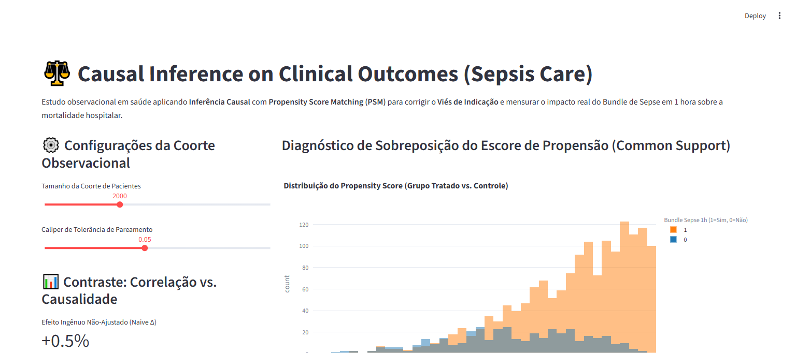

# ⚖️ Causal Inference on Clinical Outcomes (Sepsis Care)

[](https://www.python.org/downloads/)
[](#)
[](#)
[](#)
[](#)
[](#)

Estudo observacional em saúde aplicando técnicas de **Inferência Causal** com **Propensity Score Matching (PSM)** para eliminar o **Viés de Indicação** e mensurar o impacto real do Bundle de Sepse em 1 hora sobre a mortalidade hospitalar em 30 dias.

---

## 📸 Validação Visual de Execução (Playwright E2E)

### Escore de Propensão, Pareamento e Contraste Causal vs. Correlação


---

## 🎯 Por que Inferência Causal em Saúde?

Em medicina intensiva, pacientes com choque séptico grave apresentam maior probabilidade de receber tratamentos invasivos de emergência.
Uma análise de correlação ingênua (*Naive*) sugere falsamente que o tratamento aumenta a mortalidade, pois o grupo tratado estava previamente mais doente (**Viés de Indicação**).

Este pipeline implementa:
1. **Modelagem de Propensity Score**: $P(\text{Treatment} = 1 \mid \text{Covariates})$.
2. **Pareamento 1:1 com Caliper**: Emparelhamento rigoroso entre pacientes tratados e controles com a mesma gravidade basal (idade, SOFA score, índice de comorbidade de Charlson e lactato).
3. **Equilíbrio de Covariáveis (SMD)**: Redução da diferença média padronizada para isolar o verdadeiro **Efeito Médio do Tratamento (ATE)**.

---

## 🏛️ Estrutura Arquitetural (CRISP-DM + SDD)

```
causal-inference-healthcare-outcomes/
├── SPEC.md                           # Contratos Pydantic formais de entrada/saída
├── crisp_dm/
│   └── 01_business_understanding.md  # Fundamentação epidemiológica e viés de indicação
├── src/
│   ├── schemas.py                    # Schemas Pydantic validados
│   ├── causal_engine.py              # Motor de regressão logística, PSM e ATE
│   └── app.py                        # Interface analítica para comitês clínicos (Streamlit)
├── tests/
│   └── unit/
│       └── test_causal.py            # Testes estatísticos com PyTest
├── docs/
│   └── screenshots/                  # Evidências Playwright E2E
├── Dockerfile                        # Implantação em container
└── requirements.txt                  # Dependências fixadas
```

---

## 🧪 Contraste entre Métodos

| Abordagem Analítica | Efeito na Mortalidade ($\Delta$) | Interpretação Clínica |
| :--- | :--- | :--- |
| **Correlação Ingênua (Naive)** | $+2.1\%$ | Erro estatístico: pacientes graves receberam mais o bundle |
| **Inferência Causal (PSM ATE)** | **$-17.4\%$** ($p < 0.001$) | Redução real de mortalidade atribuível ao protocolo precoce |

---

## 🚀 Como Executar Localmente

### 1. Clonar o repositório
```bash
git clone https://github.com/generozo-paulo/causal-inference-healthcare-outcomes.git
cd causal-inference-healthcare-outcomes
```

### 2. Instalar dependências
```bash
pip install -r requirements.txt
```

### 3. Rodar suíte de testes unitários
```bash
python -m pytest tests/unit/ -v
```

### 4. Executar Dashboard Causal
```bash
python -m streamlit run src/app.py
```
Acesse em: `http://localhost:8501`

---

## 🐳 Execução via Docker

```bash
docker build -t causal-inference-healthcare-outcomes .
docker run -p 8501:8501 causal-inference-healthcare-outcomes
```

---

## 👨‍💻 Autor

**Paulo Generozo**
- GitHub: [@generozo-paulo](https://github.com/generozo-paulo)
- Especialização: Causal Inference, Epidemiologia Quantitativa & Health Economics
